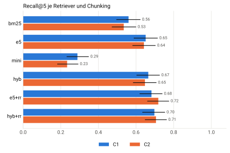
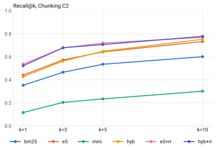
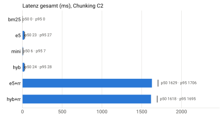

# RAG-Prüfstand – results (Run full-2026-10-25)

> Question set k1_v1: 216 model-generated answerable questions, 0 human-checked (factoid 60, colloquial 48, definition 48, crossref 36, number 24); plus 24 unanswerable questions. Written on 2026-10-25 by claude-sonnet-5-5; the owner's check of 100 questions is pending.
> Corpus: 2523 units (paragraphs) from 5 federal law(s). Source: gesetze-im-internet.de, Federal Ministry of Justice; non-official consolidated version as of 2026-10-25.

## Summary

- Pre-declared headline configuration hyb+rr-C2: recall@5 0.706 (95% CI 0.649 to 0.762, n = 216).
- e5-C2 vs mini-C2 (recall@5): +0.408 (95% CI +0.341 to +0.474) – better. This is not a pure language effect: the models also differ in size, training and in how much of long chunks they read (see limitations).
- hyb+rr-C2 vs bm25-C2 (recall@5): +0.171 (95% CI +0.113 to +0.231) – better.
- Hybrid fusion adds nothing measurable over dense retrieval alone: hyb-C2 vs e5-C2 (recall@5): +0.005 (95% CI -0.044 to +0.053) – no measurable difference.
- The gain comes from reranking: e5+rr-C2 vs e5-C2 +0.076 [+0.021, +0.137]; hyb+rr-C2 vs hyb-C2 +0.059 [+0.006, +0.110] (recall@5, 95% CI).
- For context: the highest point estimate for recall@5 belongs to e5+rr-C2 (0.718, 95% CI 0.661 to 0.774). No comparison with the headline configuration was declared in advance; the headline configuration was fixed before the run, not chosen after seeing results.

## Retrieval matrix (recall@5, 95% CI)

| Retriever | C1 | C2 |
|---|---|---|
| bm25 | 0.560 [0.497, 0.622] | 0.535 [0.473, 0.599] |
| e5 | 0.651 [0.589, 0.714] | 0.642 [0.583, 0.702] |
| mini | 0.289 [0.233, 0.347] | 0.234 [0.183, 0.292] |
| hyb | 0.665 [0.604, 0.725] | 0.647 [0.586, 0.707] |
| e5+rr | 0.682 [0.620, 0.738] | 0.718 [0.661, 0.774] |
| hyb+rr | 0.698 [0.635, 0.752] | 0.706 [0.649, 0.762] |

## All retrieval metrics

| Variant | recall@1 | recall@3 | recall@5 | recall@10 | mrr@10 | ndcg@10 |
|---|---|---|---|---|---|---|
| bm25-C1 | 0.316 [0.258, 0.374] | 0.475 [0.413, 0.539] | 0.560 [0.497, 0.622] | 0.653 [0.594, 0.712] | 0.454 [0.398, 0.512] | 0.488 [0.434, 0.541] |
| e5-C1 | 0.344 [0.284, 0.405] | 0.563 [0.504, 0.627] | 0.651 [0.589, 0.714] | 0.716 [0.658, 0.775] | 0.510 [0.456, 0.568] | 0.546 [0.494, 0.598] |
| mini-C1 | 0.083 [0.050, 0.117] | 0.210 [0.161, 0.263] | 0.289 [0.233, 0.347] | 0.363 [0.299, 0.424] | 0.191 [0.149, 0.235] | 0.220 [0.178, 0.262] |
| hyb-C1 | 0.410 [0.351, 0.472] | 0.592 [0.528, 0.654] | 0.665 [0.604, 0.725] | 0.745 [0.688, 0.803] | 0.563 [0.506, 0.622] | 0.594 [0.539, 0.648] |
| e5+rr-C1 | 0.429 [0.367, 0.489] | 0.618 [0.556, 0.679] | 0.682 [0.620, 0.738] | 0.752 [0.695, 0.808] | 0.579 [0.522, 0.634] | 0.607 [0.553, 0.658] |
| hyb+rr-C1 | 0.428 [0.367, 0.490] | 0.607 [0.539, 0.664] | 0.698 [0.635, 0.752] | 0.771 [0.715, 0.824] | 0.584 [0.528, 0.639] | 0.616 [0.563, 0.666] |
| bm25-C2 | 0.353 [0.291, 0.414] | 0.465 [0.403, 0.529] | 0.535 [0.473, 0.599] | 0.600 [0.538, 0.662] | 0.475 [0.414, 0.535] | 0.485 [0.428, 0.541] |
| e5-C2 | 0.441 [0.376, 0.502] | 0.573 [0.510, 0.633] | 0.642 [0.583, 0.702] | 0.732 [0.675, 0.787] | 0.574 [0.517, 0.631] | 0.593 [0.540, 0.644] |
| mini-C2 | 0.116 [0.076, 0.160] | 0.204 [0.153, 0.259] | 0.234 [0.183, 0.292] | 0.301 [0.243, 0.361] | 0.185 [0.141, 0.232] | 0.206 [0.162, 0.253] |
| hyb-C2 | 0.427 [0.364, 0.486] | 0.562 [0.501, 0.625] | 0.647 [0.586, 0.707] | 0.752 [0.698, 0.806] | 0.565 [0.507, 0.621] | 0.595 [0.541, 0.645] |
| e5+rr-C2 | 0.535 [0.472, 0.600] | 0.677 [0.617, 0.734] | 0.718 [0.661, 0.774] | 0.769 [0.715, 0.821] | 0.667 [0.609, 0.721] | 0.673 [0.620, 0.722] |
| hyb+rr-C2 | 0.522 [0.458, 0.585] | 0.678 [0.618, 0.735] | 0.706 [0.649, 0.762] | 0.777 [0.724, 0.828] | 0.658 [0.602, 0.715] | 0.668 [0.617, 0.719] |

## Comparisons (paired bootstrap, fixed before the run)

| A | B | Metric | Difference | 95% CI | Verdict |
|---|---|---|---|---|---|
| hyb+rr-C2 | bm25-C2 | recall@5 | +0.171 | [+0.113, +0.231] | better |
| hyb+rr-C2 | bm25-C2 | ndcg@10 | +0.184 | [+0.140, +0.230] | better |
| e5-C2 | mini-C2 | recall@5 | +0.408 | [+0.341, +0.474] | better |
| e5-C2 | mini-C2 | ndcg@10 | +0.387 | [+0.337, +0.436] | better |
| hyb-C2 | e5-C2 | recall@5 | +0.005 | [-0.044, +0.053] | no measurable difference |
| hyb-C2 | e5-C2 | ndcg@10 | +0.002 | [-0.034, +0.039] | no measurable difference |
| e5+rr-C2 | e5-C2 | recall@5 | +0.076 | [+0.021, +0.137] | better |
| e5+rr-C2 | e5-C2 | ndcg@10 | +0.080 | [+0.039, +0.122] | better |
| hyb+rr-C2 | hyb-C2 | recall@5 | +0.059 | [+0.006, +0.110] | better |
| hyb+rr-C2 | hyb-C2 | ndcg@10 | +0.074 | [+0.038, +0.110] | better |
| bm25-C2 | bm25-C1 | recall@5 | -0.025 | [-0.072, +0.023] | no measurable difference |
| e5-C2 | e5-C1 | recall@5 | -0.009 | [-0.067, +0.046] | no measurable difference |
| hyb+rr-C2 | hyb+rr-C1 | recall@5 | +0.008 | [-0.045, +0.067] | no measurable difference |

## Recall@5 by question type

| Variant | colloquial | crossref | definition | factoid | number |
|---|---|---|---|---|---|
| bm25-C1 | 0.167 [0.062, 0.271] | 0.667 [0.542, 0.778] | 0.375 [0.229, 0.500] | 0.800 [0.700, 0.900] | 0.958 [0.875, 1.000] |
| e5-C1 | 0.438 [0.312, 0.583] | 0.685 [0.565, 0.792] | 0.521 [0.375, 0.667] | 0.783 [0.667, 0.883] | 0.958 [0.875, 1.000] |
| mini-C1 | 0.083 [0.021, 0.167] | 0.287 [0.181, 0.398] | 0.250 [0.125, 0.375] | 0.350 [0.233, 0.467] | 0.625 [0.458, 0.792] |
| hyb-C1 | 0.396 [0.250, 0.521] | 0.769 [0.657, 0.866] | 0.438 [0.312, 0.583] | 0.867 [0.767, 0.950] | 1.000 [1.000, 1.000] |
| e5+rr-C1 | 0.500 [0.375, 0.646] | 0.704 [0.583, 0.815] | 0.583 [0.438, 0.708] | 0.767 [0.650, 0.867] | 1.000 [1.000, 1.000] |
| hyb+rr-C1 | 0.438 [0.292, 0.583] | 0.741 [0.625, 0.843] | 0.604 [0.458, 0.750] | 0.833 [0.733, 0.917] | 1.000 [1.000, 1.000] |
| bm25-C2 | 0.167 [0.062, 0.271] | 0.542 [0.440, 0.639] | 0.229 [0.104, 0.354] | 0.883 [0.800, 0.967] | 1.000 [1.000, 1.000] |
| e5-C2 | 0.542 [0.396, 0.667] | 0.519 [0.417, 0.625] | 0.354 [0.229, 0.500] | 0.900 [0.817, 0.967] | 0.958 [0.875, 1.000] |
| mini-C2 | 0.104 [0.021, 0.188] | 0.208 [0.111, 0.319] | 0.021 [0.000, 0.062] | 0.350 [0.233, 0.467] | 0.667 [0.458, 0.833] |
| hyb-C2 | 0.375 [0.250, 0.500] | 0.690 [0.569, 0.792] | 0.333 [0.208, 0.458] | 0.950 [0.883, 1.000] | 1.000 [1.000, 1.000] |
| e5+rr-C2 | 0.500 [0.354, 0.646] | 0.699 [0.593, 0.792] | 0.521 [0.375, 0.667] | 0.950 [0.883, 1.000] | 1.000 [1.000, 1.000] |
| hyb+rr-C2 | 0.458 [0.312, 0.604] | 0.708 [0.606, 0.801] | 0.500 [0.354, 0.646] | 0.950 [0.883, 1.000] | 1.000 [1.000, 1.000] |

## Latency per stage (ms, p50 / p95)

Measured on 50 questions, CPU: AMD64 Family 26 Model 68 Stepping 0, AuthenticAMD.

| Variant | Embedding | Search | Rerank | Total |
|---|---|---|---|---|
| bm25-C1 | 0.0 / 0.0 | 0.3 / 0.3 | 0.0 / 0.0 | 0.3 / 0.3 |
| e5-C1 | 23.0 / 27.1 | 0.5 / 0.6 | 0.0 / 0.0 | 23.5 / 27.6 |
| mini-C1 | 6.0 / 7.6 | 0.4 / 0.5 | 0.0 / 0.0 | 6.4 / 8.1 |
| hyb-C1 | 23.0 / 27.1 | 0.8 / 1.0 | 0.0 / 0.0 | 23.8 / 28.0 |
| e5+rr-C1 | 23.0 / 27.1 | 0.5 / 0.6 | 1841.9 / 1888.0 | 1867.7 / 1913.4 |
| hyb+rr-C1 | 23.0 / 27.1 | 0.8 / 1.0 | 1821.8 / 1891.2 | 1845.3 / 1916.7 |
| bm25-C2 | 0.0 / 0.0 | 0.3 / 0.4 | 0.0 / 0.0 | 0.3 / 0.4 |
| e5-C2 | 22.5 / 26.3 | 0.7 / 0.8 | 0.0 / 0.0 | 23.2 / 27.1 |
| mini-C2 | 5.5 / 6.5 | 0.5 / 0.6 | 0.0 / 0.0 | 6.0 / 7.0 |
| hyb-C2 | 22.5 / 26.3 | 1.1 / 1.2 | 0.0 / 0.0 | 23.6 / 27.5 |
| e5+rr-C2 | 22.5 / 26.3 | 0.7 / 0.8 | 1597.5 / 1681.9 | 1629.1 / 1705.9 |
| hyb+rr-C2 | 22.5 / 26.3 | 1.1 / 1.2 | 1591.2 / 1671.1 | 1617.6 / 1695.5 |

## Generation and judging

**Pending: live run.** Answers, judge scores, cost per 1,000 queries and API latency are measured only in the live run (v0.2.0). No numbers are shown here on purpose.

## Judge calibration

**Pending: live run and human labels.** Weighted Cohen's kappa and raw agreement are computed on 80 answers labelled by the owner.

## Method and limitations

- Relevance by source spans: a chunk counts when it covers at least 50% or 200 characters of a gold Absatz.
- Intervals: percentile bootstrap over questions (2000 resamples, seed 20261025); differences inside the interval are called “no measurable difference”.
- The questions are model-generated and not yet checked by any human; the owner's check of 100 questions is pending.
- The author of the questions and the primary judge of the live run are the same model (claude-sonnet-5-5); self-preference is possible. A second judge (claude-opus-5-5) and the human-checked subset bound the effect but do not remove it. The retrieval metrics need no judge.
- The headline configuration hyb+rr-C2 was fixed before the run; the fusion (reciprocal rank fusion, k = 60) has no weight tuned on the test questions.
- The gap between multilingual-e5-base and all-MiniLM-L6-v2 is not a pure language effect: the models also differ in size, training data and prefix convention, and MiniLM truncates long chunks. MiniLM is a control, not a measurement of the language advantage.
- The reranker is bge-reranker-base (trained mainly on Chinese and English); a multilingual reranker is on the roadmap.
- All models run on the CPU (no GPU); latencies hold only for the machine named.
- Platform: Windows-11-10.0.26200-SP0, CPU AMD64 Family 26 Model 68 Stepping 0, AuthenticAMD, Python 3.13.11; no GPU.
- MiniLM truncation: all-MiniLM-L6-v2 reads at most 512 tokens; with C1, 92.3% of the chunks lose their tail (visible share 92.1% on average), with C2 9.4% (99.2%). multilingual-e5-base truncates 0.0% (C1) and 0.0% (C2) of the chunks.
- Reranker truncation: bge-reranker-base reads at most 384 tokens per (question, chunk) pair; with C1, 15.1% of the reranked pairs lose their tail, with C2 4.3%. The effect on the results was not measured.

Repository: https://github.com/HARISPAARTAN/rag-pruefstand
